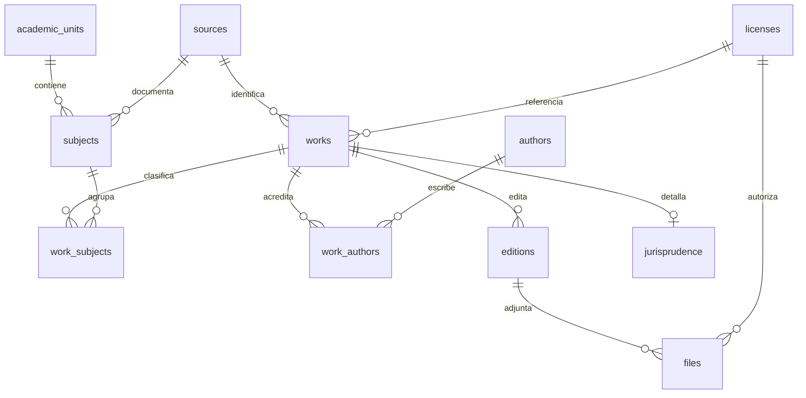

# Modelo de biblioteca y Supabase

El frontend lee exclusivamente el dataset versionado. Los contratos TypeScript
están en `src/lib/library/types.ts`; no son tipos generados por una base remota.
La migración inicial es `20261013215529_library_foundation.sql`, creada mediante
la CLI de Supabase y escrita para PostgreSQL/Supabase. **No fue aplicada contra
PostgreSQL local ni remoto.** No se arrancó Docker ni se descargaron imágenes.

| Tabla | Responsabilidad |
| --- | --- |
| academic_units | Institución, carrera y plan |
| subjects | Nombre, código, slug, año curricular, alias y fuente |
| authors | Autorías reales futuras o de demostración |
| works | Obra/ficha, tipo, título, descripción, palabras clave y estado editorial |
| work_subjects / work_authors | Relaciones N:M; un libro puede pertenecer a varias materias |
| editions | Edición, año, editorial e ISBN opcional |
| files | Edición, archivo privado, tamaño, MIME, SHA-256 y permiso |
| jurisprudence | Tribunal, expediente, fecha, tema y síntesis de una obra |
| sources | URLs, procedencia, nivel de verificación y nota |
| licenses | Etiqueta, atribución, distribución y evidencia del permiso |

Los estados editoriales son draft, review, published y archived. Publicado no
significa oficial: la fuente distingue official, secondary-crosschecked y
original-demo. Área editorial de materias no representa un departamento oficial.
Los IDs TypeScript del fixture son locales; la base usa UUID. El adaptador futuro
resolverá relaciones por código/slug y devolverá estos contratos. No hay seed SQL
que atribuya autorización a archivos futuros ni una conexión que finja sincronía.

## Seguridad preparada

RLS está habilitada en las once tablas. GRANT es explícito; anon no escribe.
Lectura pública de obras/ediciones/jurisprudencia exige estado published. Tablas
N:M comprueban la publicación de la obra; materias comprueban la unidad.
Autorías públicas deben pertenecer a una obra publicada. Índices cubren FKs y
relaciones, catálogo publicado e índices GIN de palabras clave.

Escritura authenticated exige `auth.uid()` y el claim `app_metadata.library_role`
editor/admin. No se confía en `user_metadata`. Ese claim solo podrá asignarse
mediante un servidor autorizado; requiere renovación del JWT al cambiar roles.
La evidencia de licencias no se otorga como columna SELECT a anon/authenticated;
la consulta administrativa de esa evidencia requiere backend privilegiado con
sesión/rol comprobados. Las escrituras editoriales pueden registrar evidencia.

Los archivos requieren distribución permitida con evidencia no vacía mediante
CHECK y FK compuesta. Sus rutas no tienen políticas públicas de lectura.
Storage no se crea ni se vuelve público. Antes de integrar descargas reales:
crear bucket privado, gateway autorizado que compruebe edición/obra publicada,
licencia, vigencia y origen, y URL firmada breve; no enviar service keys al cliente.
Los PDF del fixture en public son exclusivamente originales de demostración.

## Validación y siguiente fase

El SQL se analizó con pglast 7.10: 46 sentencias con sintaxis válida. Eso no valida
semántica, tipos de Auth, GRANT, funciones, RLS, Storage ni comportamiento de
PostgreSQL. Las sentencias DO y funciones necesitan además pruebas de ejecución.
No presentar este análisis como una migración probada.

En una base autorizada de pruebas: aplicar la migración, comprobar FKs, rechazo de
archivos sin permiso, lectura anon de publicados y denegación de drafts, ausencia
de writes anon, authenticated sin claim denegado, editor permitido, reclamo de
user_metadata sin efecto y evidencia privada. Añadir pruebas SQL reproducibles y
generar tipos antes de integrar Supabase. Crear entorno remoto queda para la fase
siguiente; este MVP funciona sin él.

