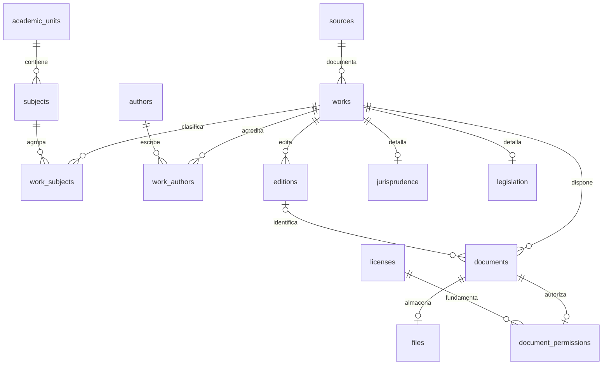

# Modelo documental y Supabase

Cuatro migraciones ordenadas: foundation del MVP, evolución administrativa,
semilla académica y búsqueda pública. Aplicadas desde cero y probadas contra
PostgreSQL 17.11 nativo. **No se han aplicado a un proyecto Supabase remoto**;
los límites de esa validación están en VALIDACION_BACKEND.md.

| Tabla                       | Responsabilidad                                                   |
| --------------------------- | ----------------------------------------------------------------- |
| academic_units / subjects   | Carrera, plan y 34 materias con códigos y slugs estables          |
| authors / work_authors      | Autores y relación N:M con obras                                  |
| works / work_subjects       | Obra intelectual, estado editorial y clasificación N:M            |
| editions                    | Ediciones bibliográficas independientes del binario               |
| documents                   | PDF, enlace HTTPS o referencia; obra y edición opcional           |
| files                       | Un binario por documento, bucket privado, SHA-256, bytes, páginas |
| jurisprudence / legislation | Metadatos judiciales y legislativos                               |
| sources / licenses          | Procedencia, verificación, distribución, evidencia y vigencia     |
| document_permissions        | Verificación por documento, evidencia, administrador y fechas     |
| editorial_events            | Auditoría inmutable de cambios de estado de obra/documento        |
| private.library_admins      | Administradores activos, aprovisionados por propietario SQL       |

15 tablas públicas con RLS más la tabla privada administrativa. FK, UNIQUE,
CHECK, índices de relaciones, índices parciales de catálogo y GIN de keywords.
Políticas públicas comprueban publicación y elegibilidad del documento. Todos
los writes exigen membresía y sesión Auth vigentes; permisos y auditoría son
privados. Las políticas antiguas basadas en app_metadata se reemplazan.

La semilla solo incorpora unidad, procedencia, 34 materias y marcadores pendientes
de fuente/licencia. No crea obras ni autorizaciones ficticias. Nombres/códigos
conservan el cotejo secundario y pendiente primario de DATOS_Y_FUENTES.md.

Los contratos de aplicación en `database.types.ts` se verifican contra columnas
SQL por `scripts/check-schema-contract.mjs`; **no se presentan como tipos generados
por Supabase remoto**. El adaptador mapea UUIDs a códigos estables del frontend.

Proceso editorial, seguridad de Storage, aprovisionamiento de administradores,
configuración y limitaciones: BACKEND_ADMIN.md. Las pruebas utilizan fixtures de
plataforma solo en una base desechable; nunca aplicarlos a Supabase real.
